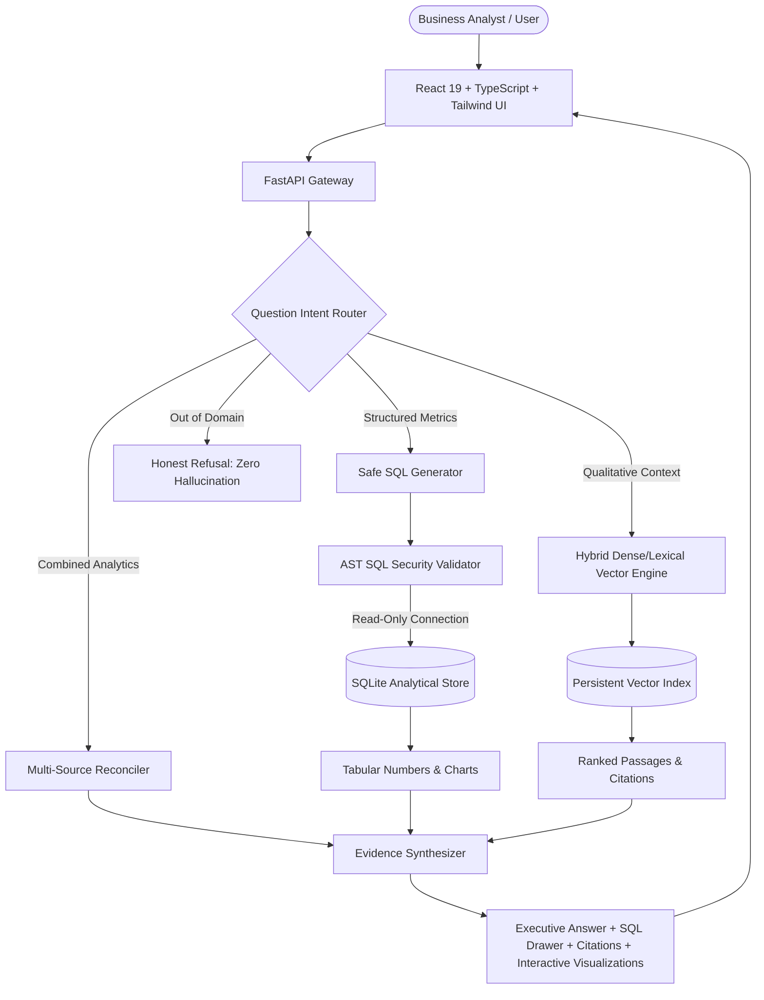

# InsightRAG — Evidence-Grounded Business Analytics Copilot

InsightRAG is an enterprise-grade business intelligence platform that combines **deterministic SQL analytics** over relational databases with **retrieval-augmented generation (RAG)** over unstructured business documents (quarterly reviews, regulatory filings, commercial pricing policies).

It is specifically designed to eliminate the hallucination risks common in generic LLM chatbots by strictly separating **calculated database facts** from **retrieved document citations**, enforcing AST-level SQL security, and providing an automated **Evaluation Lab** with quantitative benchmarks.

---

## 1. System Architecture



---

## 2. Core Capabilities

### A. Strict Evidence Separation
- **Calculated Facts**: Numerical metrics (revenue, margins, volume) are computed deterministically via SQLite, never generated from an LLM's arithmetic memory.
- **Retrieved Evidence**: Qualitative explanations (management discussions, pricing guidelines) cite exact document names, page numbers, and passage identifiers.
- **Citation Audit**: Every citation is verified against the passages actually returned by the retrieval engine.

### B. AST-Based SQL Security Guardrails
Unlike naive systems that rely on fragile regex checks, InsightRAG uses Abstract Syntax Tree (`sqlparse`) parsing:
- **Allowlisted Queries**: Permitted to run `SELECT` statements and read-only Common Table Expressions (`WITH ... SELECT`).
- **Prohibited Statements**: Rejects `INSERT`, `UPDATE`, `DELETE`, `DROP`, `ALTER`, `CREATE`, `ATTACH`, `PRAGMA`, and chained multi-statements.
- **Execution Level**: Opens SQLite connections with OS-level URI read-only mode (`?mode=ro`).
- **Enforced Row Limits**: Automatically applies `LIMIT 500` and query timeouts.

### C. Hybrid Dense + Lexical Vector Search
- Sliding-window document chunking with configurable window size and overlap preserving page metadata.
- L2-normalized sublinear TF-IDF vector embeddings combined with lexical keyword overlap bonuses (Dense + BM25-style hybrid retrieval).
- Document support for both **PDF** and **TXT** files.
- Search Preview Inspector to test retrieval before asking questions.

### D. Automated Evaluation Lab
Provides quantitative, un-fabricated benchmark measurements:
- **SQL Execution Accuracy (%)**: Evaluates valid execution of structured queries.
- **Retrieval Recall@K (%)**: Measures whether target documents are retrieved in the top $K$ passages.
- **Citation Support Fidelity (%)**: Validates evidence grounding.
- **Hallucination Rejection Accuracy (%)**: Measures proper rejection of out-of-domain queries.
- **Latency (ms)**: Measures query execution and synthesis duration.

---

## 3. Quickstart & Local Setup

### Prerequisites
- Python 3.11+ (Python 3.12, 3.13, or 3.14 supported)
- Node.js 18+ and npm

### Step 1: Clone and Set Up Backend
```bash
# Clone and enter directory
cd insightrag

# Install backend dependencies
pip install -r backend/requirements.txt

# (Optional) Copy environment template
cp .env.example .env
```

### Step 2: Build the Frontend
```bash
cd frontend
npm install
npm run build
cd ..
```

### Step 3: Launch InsightRAG
```bash
# Run with python path set to backend
# Windows PowerShell:
$env:PYTHONPATH="backend"
python backend/app/main.py

# Linux / macOS:
PYTHONPATH=backend python backend/app/main.py
```
Open **[http://localhost:8000](http://localhost:8000)** in your browser.

> [!TIP]
> To run in active frontend development mode with Vite hot-reloading:
> 1. Start backend: `python -m uvicorn app.main:app --reload --port 8000` (from `backend/`)
> 2. Start frontend: `npm run dev` (from `frontend/` on port 3000, proxies `/api` to 8000).

---

## 4. Running Automated Tests

Run the full pytest suite (data profiling, SQL AST security, RAG retrieval, synthesis, evaluation metrics, and end-to-end smoke tests):

```bash
# Windows PowerShell:
$env:PYTHONPATH="backend"
python -m pytest backend/tests/ -v

# Linux / macOS:
PYTHONPATH=backend pytest backend/tests/ -v
```

All 31 test cases verify:
- Safe and unsafe SQL queries (including injection and catalog attacks)
- Data profiling and missing value calculations
- PDF and TXT text extraction and chunk metadata preservation
- Combined SQL and RAG multi-source reconciliation
- Automated benchmark scoring in the Evaluation Lab

---

## 5. Deployment Guide -- At Render

### Docker Deployment
Run using Docker Compose:
```bash
docker-compose up --build -d
```
Access at `http://localhost:8000`. Persistent database and vector indexes are stored in the `insightrag-storage` volume.

It is designed to reduce hallucination risks by separating calculated database facts from retrieved document evidence, validating SQL queries before execution, and providing an automated Evaluation Lab for quantitative assessment.

Live Demo: InsightRAG on Render

API Documentation: FastAPI Swagger UI

